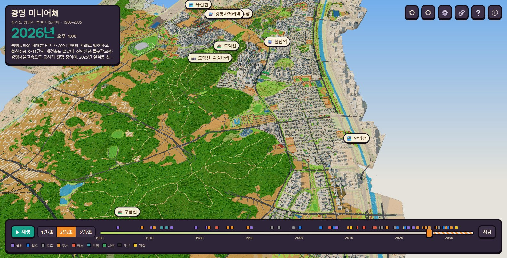
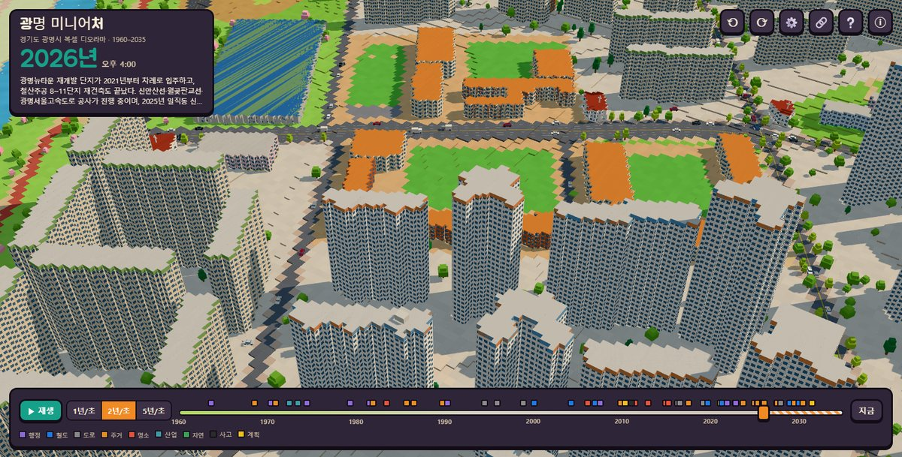
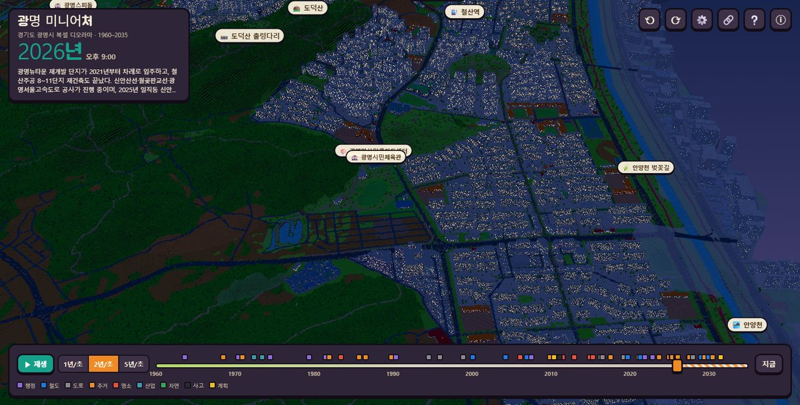
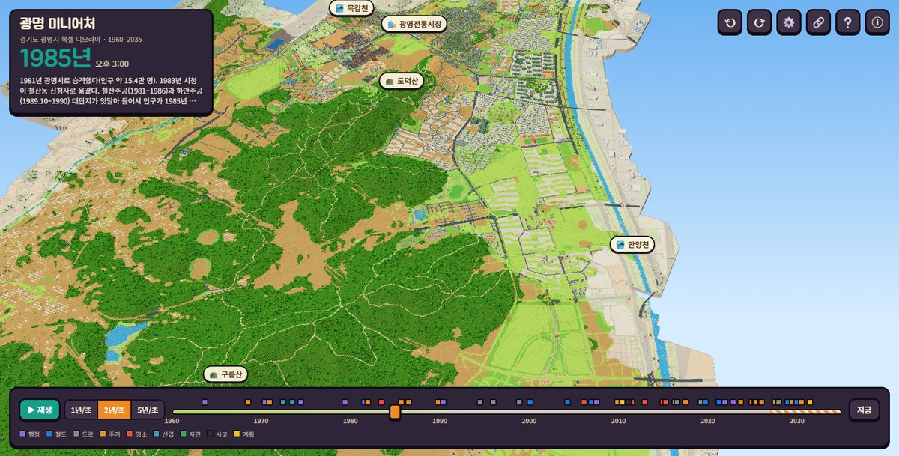
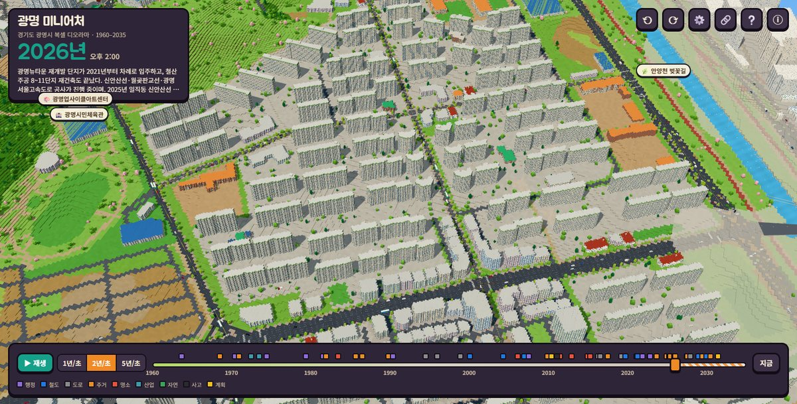
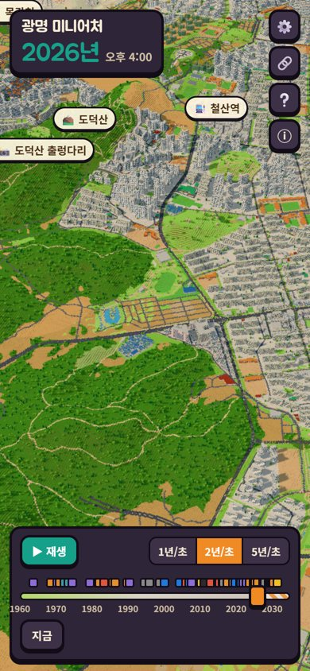
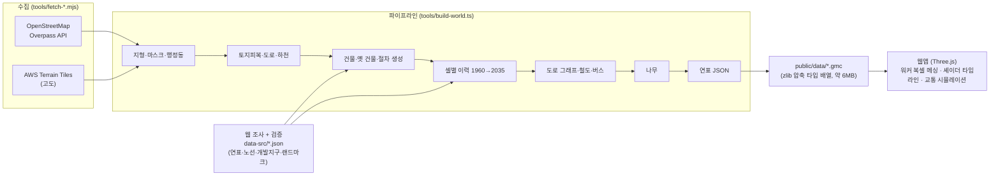

<div align="center">

# 🏙️ 광명 미니어처 · GM City

**경기도 광명시를 실제 데이터로 옮겨 줄인 복셀 아트 3D 디오라마**

롤러코스터 타이쿤처럼 아기자기하게, 길건너 친구들처럼 네모나게.<br/>
1960년 논밭에서 오늘의 아파트 숲, 2030년대 계획까지 타임라인으로 넘겨 보세요.

[](https://jeiel85.github.io/gm-city/)

[](https://github.com/jeiel85/gm-city/actions/workflows/deploy.yml)


-7ebc6f?logo=openstreetmap&logoColor=white)




</div>

## ✨ 무엇을 볼 수 있나요

| | |
|---|---|
| 🗺️ **진짜 광명시** | 광명시 경계(38.5km²)·행정동 19개·지형 고도·도로 8,400여 구간·건물·하천을 OpenStreetMap 과 고도 자료에서 5m 복셀 격자로 옮겼습니다. |
| ⏳ **타임라인 1960 → 2035** | 슬라이더를 움직이면 논밭이 주거지가 되고, 철산주공 5층 아파트가 헐리고 새 단지가 **공사 중 → 한 층씩 솟아오르고**, 3기 신도시 부지가 공사장으로 바뀝니다. 연표 60건이 사건 점과 알림으로 나옵니다. |
| 🚇 **움직이는 도시** | 실제 노선 경로를 따라 달리는 **버스 45개 노선**, **7호선·KTX·1호선 광명셔틀**(역 정차·가감속), 차로를 지키고 신호에 서는 **자동차**, 보도를 걷는 **사람들**. |
| 🔍 **확대해서 구경** | 도시 전체 조망부터 골목 한 칸까지. 건물·사람·버스·열차를 누르면 정보 카드가 뜨고 **🎥 따라가기**로 버스나 열차에 탈 수 있습니다. |
| 🌗 **낮과 밤** | 해가 동쪽에서 떠 남쪽을 지나 서쪽으로 지고, 밤에는 아파트 창문과 교회 십자가, 자동차 전조등이 켜집니다. |
| 🕳️ **지하 투시** | 땅 밑 7호선·신안산선 터널과 지하철을 땅에 비쳐 봅니다(X 키). |
| 🎮 **RCT 등각 보기** | 롤러코스터 타이쿤처럼 비스듬한 등각 카메라와 90° 회전(Q/E). 미니어처 느낌의 틸트시프트 효과도 있어요. |
| 🔗 **장면 공유** | 연도·시각·카메라 위치가 주소에 담겨, 링크 하나로 같은 장면을 공유합니다. |

## 📸 둘러보기

| 가까이서 본 아파트 단지와 도로 | 밤의 광명 |
|---|---|
|  |  |
| **1985년**: 철산주공이 막 들어서고 하안동은 아직 논 | **하안동 주공 단지**와 안양천 벚꽃길 |
|  |  |

<p align="center"><br/><sub>휴대폰에서도 터치로 이동·확대·회전할 수 있어요</sub></p>

## 🎮 조작법

| 마우스 | 터치 | 키보드 |
|---|---|---|
| 왼쪽 드래그: 이동<br/>오른쪽 드래그: 회전·기울이기<br/>휠: 확대·축소<br/>클릭: 정보 보기 | 한 손가락: 이동<br/>두 손가락: 확대·회전<br/>탭: 정보 보기 | `WASD` 이동 · `Q` `E` 90° 회전 · `+` `-` 확대<br/>`Space` 타임라인 재생 · `[` `]` 1년씩<br/>`T` 시계 · `L` 이름표 · `X` 지하 투시 · `R` 처음 시점 · `Esc` 해제 |

## 🧱 어떻게 만들었나



- **복셀 지형**: 셀 색은 셰이더가 셀 텍스처(연도별 토지피복 3단계)에서 골라 칠합니다. 그래서 높이만 같으면 색이 달라도 윗면을 크게 병합할 수 있고, 연도를 바꿔도 메시를 다시 만들지 않습니다.
- **건물의 일생**: 건물마다 착공·준공·철거 연도를 데이터 텍스처에 담아, 버텍스 셰이더가 연도에 맞춰 층 단위로 올리거나 숨깁니다. 공사 중에는 회색 골조와 초록 안전망, 옆에는 타워크레인이 섭니다.
- **교통**: OSM 도로를 교차로에서 쪼갠 그래프 위를 차가 우측 통행 차로로 달리고, 버스·열차는 OSM `route` 관계에서 조립한 실제 노선 경로를 따라갑니다.
- 자세한 설계는 [ARCHITECTURE.md](ARCHITECTURE.md), 되돌리기 어려운 결정은 [DECISIONS.md](DECISIONS.md) 에 있습니다.

## ⚠️ 데이터에 대해 솔직하게

이 디오라마는 실제 데이터를 바탕으로 하지만 **모든 것이 사실 그대로는 아닙니다.** 앱의 ⓘ 창과 건물 정보 카드에도 같은 내용을 표시합니다.

- **건물 준공 연도**는 OSM 에 기록된 값(약 1,100동)을 우선 쓰고, 없으면 단지명 조사 자료 → 개발지구 연도 → 주변 건물 순으로 **추정**합니다. 건물을 누르면 연도의 출처가 나옵니다.
- OSM 에 건물이 비어 있는 저층 주거지·상가·공장·비닐하우스는 **절차 생성**으로 채웠습니다. 실제 배치와 다릅니다.
- 사라진 옛 건물(광명뉴타운 저층 주택가, 철산주공 5층 아파트, 택지 개발 전 농가)과 **1960~70년대 경관**은 조사 자료를 바탕으로 한 **근사 복원**입니다.
- OSM 에 토지피복이 없는 시 남부의 숲·논밭·비닐하우스는 **고도와 경사로 추정**했습니다.
- **2027년 이후**는 공개된 계획(광명시흥 3기 신도시, 신안산선·월곶판교선 등)에 따른 공사 표시일 뿐 실제 설계가 아니며, 일정은 바뀔 수 있습니다.
- 사람·차량·버스·열차의 움직임은 **시뮬레이션**입니다. 노선 경로는 실제이지만 시간표는 아닙니다. 사람 이름은 가상입니다.
- OSM 원본을 이 프로젝트에서만 바로잡은 곳은 [`data-src/overrides.json`](data-src/overrides.json) 에 이유와 함께 적어 둡니다. 예: 광명시민체육관 앞마당이 건물로 그려져 있던 것.

## 🛠️ 직접 실행하기

Node.js 20 이상이 필요합니다(데이터 파이프라인은 Node 24 의 TypeScript 직접 실행을 씁니다).

```bash
npm install
```

```bash
npm run dev
```

브라우저에서 `http://localhost:5173/gm-city/` 를 엽니다. 저장소에 가공된 데이터(`public/data`)가 들어 있어 바로 실행됩니다.

데이터를 처음부터 다시 만들려면(네트워크 필요, 수 분):

```bash
npm run data:fetch
```

```bash
npm run data:build
```

검사:

```bash
npm run typecheck
```

```bash
npm test
```

### 폴더 구조

```
src/
  data/     데이터 계약(코드표·좌표계·.gmc 포맷·로더)
  core/     전역 상태·공유 uniform·모듈 인터페이스
  engine/   렌더러·카메라·조작·낮밤·후처리·피킹
  world/    지형(워커 메싱)·수면·도로 표시·교량·건물·나무
  sim/      자동차·버스·열차·보행자 시뮬레이션과 복셀 모델
  ui/       타임라인·패널·정보 카드·이름표·URL 공유
tools/
  fetch-*.mjs      OSM·고도 수집
  build-world.ts   데이터 파이프라인 진입점
  pipeline/        단계별 구현
  dev/             미리보기·헤드리스 캡처 도구
data-src/   웹 조사 후 검증한 연표·노선·개발지구·랜드마크, 수동 보정
public/data 가공된 배포 데이터
```

## 📜 라이선스와 출처

- **코드**: [MIT](LICENSE)
- **지도 데이터**: © [OpenStreetMap](https://www.openstreetmap.org/copyright) contributors, [ODbL 1.0](https://opendatacommons.org/licenses/odbl/). `public/data` 의 파생 데이터도 ODbL 을 따릅니다.
- **고도**: [AWS Terrain Tiles](https://registry.opendata.aws/terrain-tiles/) (Mapzen Terrarium; SRTM 등)
- **연표·노선·개발지구·랜드마크**: 공개 자료(위키백과, 디지털광명문화대전, 광명시청, 언론 보도 등)를 조사하고 별도로 검증했습니다. 항목별 출처 URL 은 `data-src/*.json` 에 있습니다.
- 롤러코스터 타이쿤·길건너 친구들은 분위기의 영감일 뿐 원작의 에셋은 쓰지 않았습니다.
